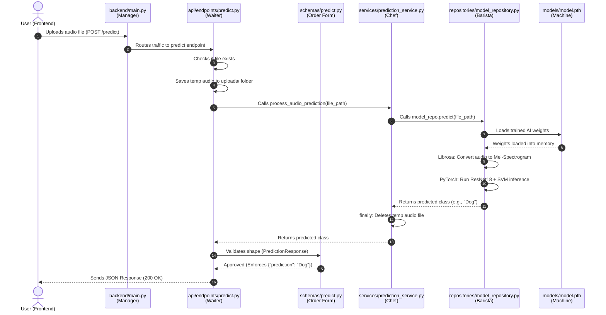

# Sound Classification Request Flow

This diagram illustrates exactly what happens when a user uploads an audio file for prediction. It tracks the request as it travels through each file in the Layered Architecture.

